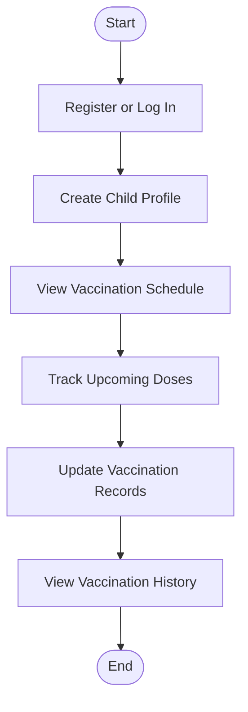

# 💉 Child Vaccination Management System

### 🧒 Smart Vaccination Tracking for a Healthier Future

A web-based healthcare management application built using **ASP.NET and SQL Server** to help parents manage children's vaccination schedules, maintain immunization records, and track important vaccination dates in one convenient place.

> 🩺 **Our Goal:** Make childhood immunization tracking simpler, more organized, and more accessible for every parent.

---

## 🌟 Overview

Keeping track of a child's vaccination schedule can be challenging for busy parents. Missing an important vaccination date can affect timely immunization, while maintaining physical records can make information difficult to access.

The **Child Vaccination Management System** provides a centralized digital platform where parents can manage child profiles, view vaccination schedules, maintain vaccination history, and track upcoming doses.

By combining technology with preventive healthcare, the application aims to encourage timely immunization and make vaccination record management easier.

---

## ✨ Key Features

| Feature | Description |
|---|---|
| 🔐 **Secure Authentication** | Registration and login for authorized users. |
| 👶 **Child Profile Management** | Create and manage children's personal profiles. |
| 📅 **Vaccination Scheduling** | Organize vaccination schedules and important due dates. |
| 💉 **Vaccination History** | Maintain records of completed vaccinations. |
| 🔔 **Vaccination Reminders** | Help users track upcoming vaccination dates. |
| 📊 **Centralized Dashboard** | Access relevant child and vaccination information conveniently. |
| 🖥️ **User-Friendly Interface** | Simple navigation for users with different levels of technical knowledge. |
| 🗂️ **Digital Record Management** | Keep vaccination information organized in one place. |

---

## 🛠️ Technology Stack

<p>
  
  
  
  
  
  
</p>

- **Frontend:** HTML, CSS, JavaScript
- **Backend:** ASP.NET with C#
- **Database:** Microsoft SQL Server
- **IDE:** Visual Studio


---

## 🔄 How It Works



1. **Register or log in** to access the application.
2. **Create a child profile** to organize vaccination information.
3. **View vaccination schedules** and relevant due dates.
4. **Track upcoming doses** to help avoid missed appointments.
5. **Maintain vaccination records** as doses are completed.
6. **Review vaccination history** whenever required.

---

## 🎯 Project Objectives

- Digitize traditional vaccination record management.
- Improve access to children's immunization information.
- Help parents stay aware of upcoming vaccination dates.
- Maintain structured and organized vaccination histories.
- Promote awareness of timely childhood immunization.
- Explore the role of web technology in preventive healthcare.

---

## 🚀 Getting Started

Follow these steps to run the project locally.

### 📋 Prerequisites

Ensure the following tools are installed:

- [Visual Studio](https://visualstudio.microsoft.com/)
- ASP.NET-compatible .NET Framework or .NET SDK
- Microsoft SQL Server
- SQL Server Management Studio (SSMS), if needed

### 📥 Installation

**1. Clone the repository**

```bash
git clone <your-repository-url>
```

**2. Open the project**

Open the `.sln` solution file in Visual Studio. If your project has no solution file, open the project file directly.

**3. Configure the database**

- Create or restore the SQL Server database.
- Update the connection string in `Web.config`, `appsettings.json`, or the relevant configuration file, depending on your project type.
- Execute the required SQL scripts, if provided.

**4. Restore dependencies**

Restore the required NuGet packages if applicable.

**5. Build and run**

Build the solution and run the application from Visual Studio.

**6. Explore the application**

Register or log in and explore the available child profile and vaccination management features.

> 💡 Refer to your actual project configuration and database scripts for the exact setup requirements.

---

## 🔮 Future Enhancements

The project can be extended with additional features to improve usability and accessibility.

- 📩 **SMS and Email Alerts** — Send notifications for upcoming vaccination dates.
- 📄 **Downloadable Reports** — Generate vaccination history reports for record keeping.
- 📈 **Growth Tracking Charts** — Visualize a child's growth over time.
- 🏥 **Healthcare Provider Access** — Support collaboration between parents and authorized healthcare professionals.
- 📱 **Mobile-Friendly Experience** — Improve usability across smartphones and tablets.
- 📊 **Analytics and Reporting** — Summarize vaccination records and identify incomplete schedules.

---

## 🌍 Real-World Impact

Childhood immunization plays an important role in preventive healthcare. However, vaccination information can become scattered across paper records, and busy schedules can make due dates difficult to remember.

This project explores how a digital platform can help address these challenges by:

- Making vaccination information easier to organize and retrieve.
- Helping parents monitor upcoming vaccination dates.
- Maintaining a consistent digital history of completed doses.
- Supporting awareness of timely immunization.

**The vision is simple: better-organized records, better-informed parents, and more convenient vaccination tracking.**

*The application supports record management and reminders; it does not replace medical advice from qualified healthcare professionals.*

---

## 👩‍💻 Project Details

| Category | Details |
|---|---|
| **Project Name** | Child Vaccination Management System |
| **Domain** | Healthcare / Web Development |
| **Backend** | ASP.NET with C# |
| **Database** | Microsoft SQL Server |
| **Purpose** | Digital vaccination scheduling and record management |
| **Project Type** | Academic Project |

---

## 🤝 Contributions

Suggestions and improvements that enhance the usability, maintainability, and functionality of the project are welcome.

If you would like to contribute:

1. Fork the repository.
2. Create a feature branch.
3. Commit your changes.
4. Submit a pull request.

---

## ⭐ Support

If you find this project interesting, consider giving the repository a ⭐ on GitHub!

Your support helps encourage further development and learning.

---

<p align="center">
  <b>💙 Building Digital Solutions for a Healthier Tomorrow 💙</b>
</p>
